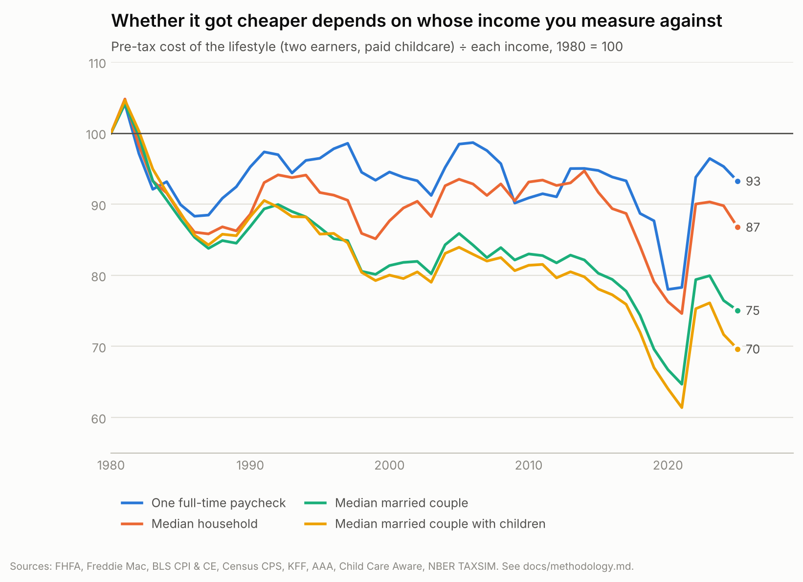
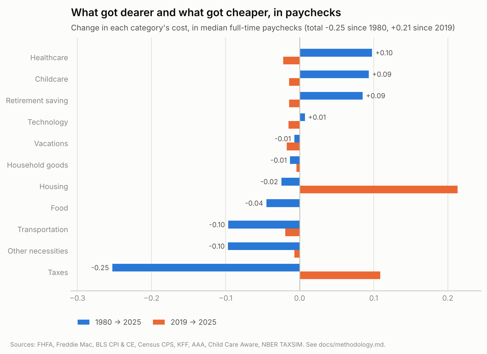
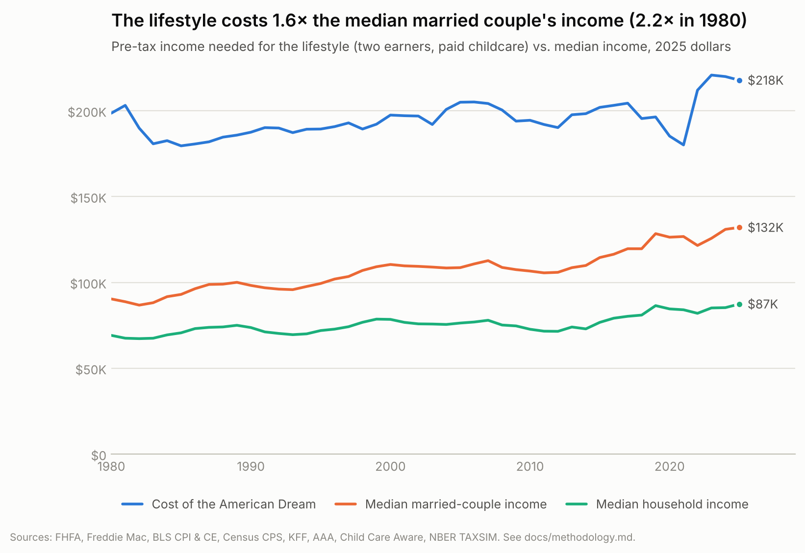
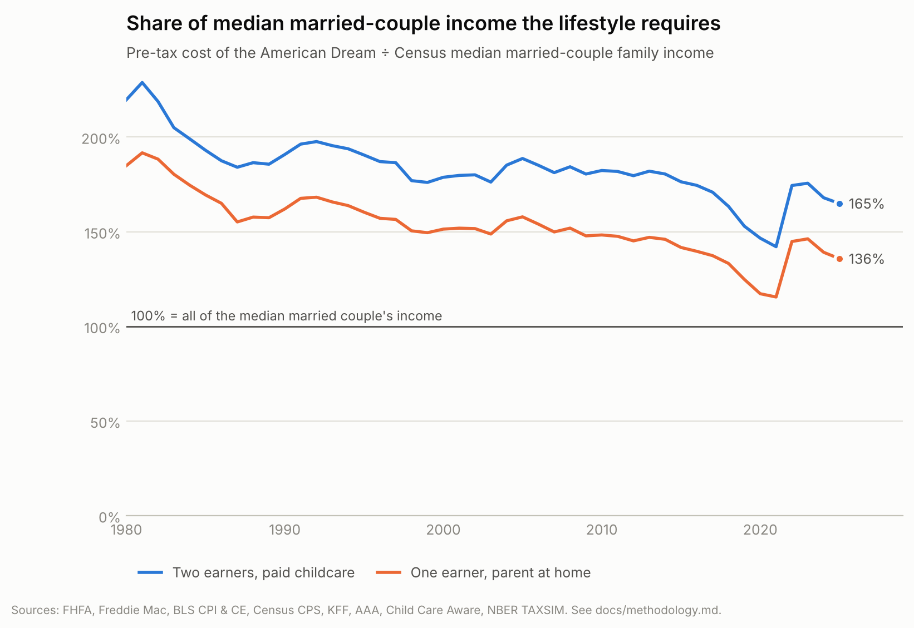
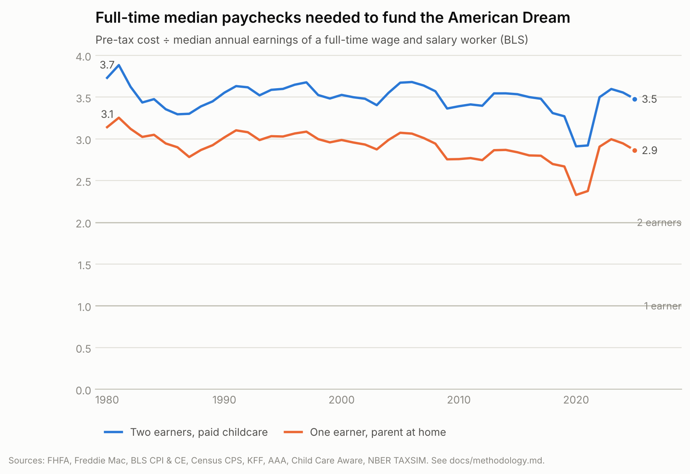
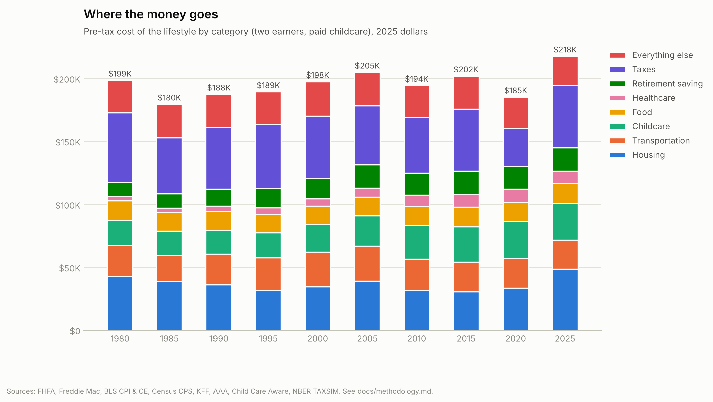

# American Dream Index

How much pre-tax income does a family of four need to live a comfortable
middle-class "American Dream" lifestyle, and how has that changed since 1980
compared with what families actually earn?

The lifestyle:

| Category | What's priced |
| --- | --- |
| Housing | A typical existing home (median ≈ 3 bed / 2 bath), 20% down, 30-year fixed mortgage at that year's rate, property tax, insurance, maintenance, utilities |
| Transportation | Two cars driven 15,000 miles a year: depreciation, financing, fuel, insurance, maintenance, fees |
| Childcare | Two children in full-time centre care (two-earner household only) |
| Food | Groceries and meals out for four |
| Household goods | 60" TV, refrigerator, freezer, washer, dryer, microwave, range (replacement reserve), furniture |
| Technology | Two smartphones and plans, home internet, cable TV |
| Healthcare | Worker share of an employer family health plan, plus out-of-pocket costs |
| Vacations | One domestic family trip a year, one international trip every five years |
| Retirement | Saving enough to retire at 55–60 (57.5 by default) |
| Other necessities | Clothing, personal care, household supplies, entertainment, miscellaneous |
| Taxes | Federal and state income tax and FICA on the income needed to pay for all of the above |

Two households are modeled every year:

* **A: two earners**, both children in paid childcare.
* **B: one earner**, a parent at home, no childcare bill.

Each is compared with three income benchmarks: Census median household
income, Census median married-couple family income, and the number of
median full-time paychecks (BLS) the lifestyle requires.

## Results

| | 1980 | 2019 | 2025 |
|---|---|---|---|
| Pre-tax cost, two earners + childcare (2025 $) | $198,700 | $196,400 | $217,800 |
| Median married-couple income (2025 $) | $90,400 | $128,400 | $132,100 |
| Cost as share of that income: two earners | 220% | 153% | 165% |
| Cost as share of that income: one earner, parent at home | 185% | 125% | 136% |
| Full-time median paychecks needed: two earners | 3.7 | 3.3 | 3.5 |

* **The full lifestyle has never been within reach of the median family.**
  The two-earner version takes 1.4–2.3× the median married couple's income
  in every year (peaking at 2.3× in 1981); the one-earner version never less than 1.15×.
* **It did not get cheaper per worker.** It cost 3.7 median full-time
  paychecks in 1980, 3.4 in 1985 and 3.5 in 2025. It looks cheaper against
  married couples' income because couples now bring in 2.1 paychecks instead
  of 1.7 (three-quarters of the improvement since 1980), and married parents
  are a smaller, better-off group (17% of households, down from 31%).
* **The mix shifted.** Childcare, health insurance and retirement saving each
  take about 0.1 more paychecks than in 1980; cars, clothing, food and above
  all taxes take fewer. Excluding taxes, the lifestyle costs exactly 2.69
  paychecks in both 1980 and 2025.
* **It got worse recently.** Since 2019 the cost per paycheck is up 6% (19%
  since 2021), all of it housing; home prices are a record 4.8× median
  household income.

Why the index and the popular perception differ, with every number
decomposed: [`docs/disconnect.md`](docs/disconnect.md).




Charts are in [`charts/`](charts), the year-by-year numbers in
[`data/processed/summary.csv`](data/processed/summary.csv), and an
interactive version (sliders for retirement age, returns, home prices, down
payment and childcare) in [`web/index.html`](web/index.html), published at
https://claude.ai/artifact/QegXtAQLvniovHtacvvmdV.






## Method in brief

* **Real historical series where they exist**: FHFA house price index, Freddie
  Mac mortgage rates, Fed auto loan rates, KFF employer health premiums,
  Census incomes, BLS earnings, SSA life expectancy, DOL/BLS pension coverage.
* **Anchor + index everywhere else**: each item starts from a 2024 national
  figure (AAA, Child Care Aware, BLS Consumer Expenditure Survey) and moves
  with the matching CPI component.
* **Era-typical goods**: for phones, TVs, appliances, clothing and
  entertainment, quality-adjusted price indexes give absurd results over 45
  years (a 2024-quality 60" TV would have "cost" ~$50,000 in 1980), so these
  follow what married couples with children actually spent each year (BLS CE).
* **Taxes** from NBER TAXSIM 35, for every state, population-weighted, with
  itemized mortgage interest and property tax and the child and dependent
  care credit.
* **Retirement** saving funds the retired couple's spending from the
  retirement age to the longer-lived spouse's life expectancy plus three
  years, net of Social Security claimed at 62 and expected pension income,
  including individual-market health insurance until Medicare.

Full details, sources and caveats: [`docs/methodology.md`](docs/methodology.md).
Every assumption is in [`config/assumptions.toml`](config/assumptions.toml).

## Running it

```bash
pip install -r requirements.txt
python -m adi all          # build data, charts and the web page
python -m adi build        # just the numbers -> data/processed/
python -m adi disconnect   # yardstick, decomposition and sensitivity analysis
python -m adi fetch --refresh   # re-download every raw source
python -m pytest
```

Raw downloads are cached in `data/raw/` (committed), so a build runs offline.
TAXSIM results are cached by input hash in `data/raw/taxsim/`; changing the
housing or childcare assumptions re-runs TAXSIM through its web service
(a few minutes). BLS rejects downloads without a contact address in the
User-Agent: set `ADI_CONTACT_EMAIL` before `--refresh`.

## Layout

```
adi/            model code (sources, data, components, retirement, taxes, index, charts, web)
config/         assumptions.toml
data/raw/       cached downloads (FRED, BLS CPI & CE extracts, Census tables, TAXSIM)
data/reference/ hand-collected series with sources in their headers
data/processed/ model outputs
charts/         PNG + SVG charts
docs/           methodology
web/            interactive page (template + generated index.html)
tests/
```
